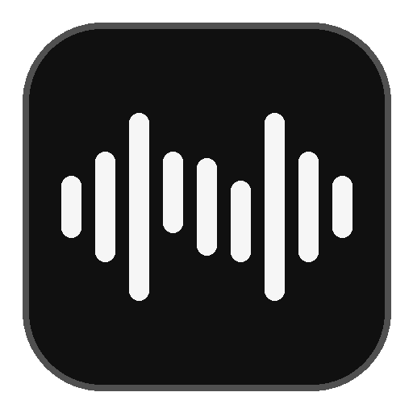
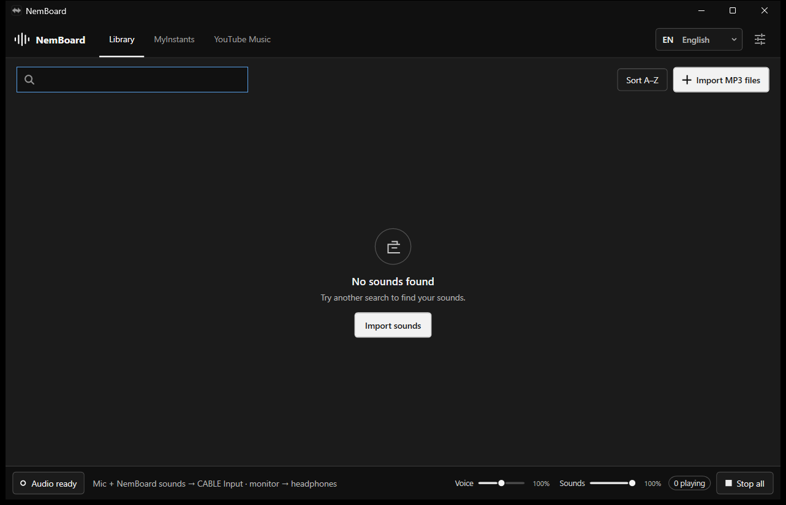
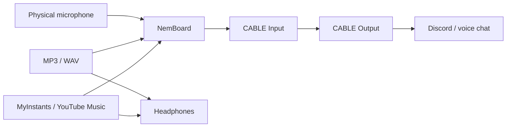

<div align="center">
  
  <h1>NemBoard</h1>
  <p>A free and open-source soundboard for Windows, built for Discord, games and voice chat.</p>
  <p>
    
    
    
  </p>
</div>



NemBoard mixes your microphone with imported sounds, MyInstants and YouTube Music, then sends the result to **VB-CABLE**. Your regular microphone and headphones remain the default Windows devices; voice-chat applications only need to use **CABLE Output** as their microphone.

## Features

- Import MP3 and WAV files, including drag and drop.
- Play sounds from a compact soundboard library.
- Browse MyInstants and YouTube Music inside the application.
- Send your voice and NemBoard sounds to VB-CABLE.
- Hear sound effects and browser audio through your headphones at the same time.
- Keep Discord and other desktop audio out of the virtual microphone mix to prevent echo.
- Adjust voice and sound levels independently.
- Configure the microphone, headphones and virtual cable with a short first-run guide.
- Use the interface in English, French, Spanish, German, Italian or Portuguese.

## Audio routing



NemBoard captures only its embedded browser process. Incoming call audio and other Windows applications are not sent back into VB-CABLE.

## Installation

1. Download `NemBoard-Setup-x64.exe` from the repository's **Releases** page.
2. Run the installer.
3. Leave **Install VB-CABLE automatically if missing** enabled.
4. Restart Windows if the VB-CABLE driver was installed.
5. Follow NemBoard's first-run audio guide.

The installer is self-contained and does not require a separate .NET installation.

### Discord setup

In **Discord → User Settings → Voice & Video**:

- Set **Input Device** to `CABLE Output (VB-Audio Virtual Cable)`.
- Keep **Output Device** set to your normal headphones or speakers.

Keep your normal microphone and headphones selected in Windows. NemBoard handles the virtual-microphone mix while it is running.

## Build from source

Requirements:

- Windows 10 or Windows 11, x64
- [.NET 8 SDK](https://dotnet.microsoft.com/download/dotnet/8.0)
- [Inno Setup 6 or 7](https://jrsoftware.org/isdl.php) to build the installer
- Microsoft WebView2 Runtime for the embedded browser

Run from PowerShell:

```powershell
.\scripts\build.ps1
```

The script restores dependencies, runs the test suite, publishes a self-contained Windows x64 application and creates the installer in `dist/`.

Useful options:

```powershell
.\scripts\build.ps1 -SkipTests
.\scripts\build.ps1 -SkipInstaller
```

## Project structure

```text
Source/
  Soundboard.App/         WPF application, audio routing and WebView2
  Soundboard.Core/        Sound library, search and persistent settings
  Soundboard.Core.Tests/  Automated tests
installer/                Inno Setup source and VB-CABLE package
scripts/                  Build script
docs/images/              README images
```

User settings, imported sounds and the WebView2 profile are stored in `%LOCALAPPDATA%\NemBoard`. They are kept when the application is uninstalled.

## Third-party software

- [VB-CABLE](https://vb-audio.com/Cable/) is donationware by VB-Audio Software. It is included for automatic installation under its own distribution terms. See `installer/VB-CABLE-NOTICE.txt`.
- [NAudio](https://github.com/naudio/NAudio) is used for Windows audio capture and playback.
- [Microsoft WebView2](https://developer.microsoft.com/microsoft-edge/webview2/) powers the embedded browser.
- [Inter](https://rsms.me/inter/) is distributed under the SIL Open Font License 1.1.

## License

NemBoard's source code is licensed under the [GNU General Public License v3.0](LICENSE). If you distribute NemBoard or a derivative work, you must preserve the GPL-3.0 license and make the corresponding source code available. Third-party components remain covered by their respective licenses.
